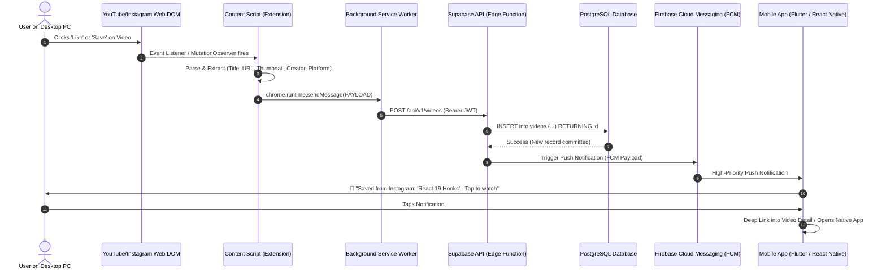
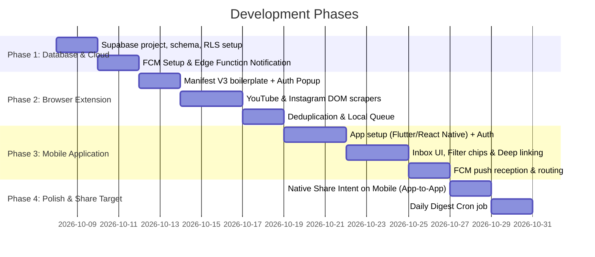

# 📌 Deep Technical Specification & Blueprint: "Elio AI"

**Cross-Platform (Browser Extension + Mobile App + Realtime Cloud) Video Sync & Reminder Ecosystem**

---

## 1. Table of Contents

1. [Core Problems & Solutions](#2-core-problems--solutions)
2. [Complete System Architecture & Data Flow](#3-complete-system-architecture--data-flow)
3. [Deep-Dive: Browser Extension (Client 1)](#4-deep-dive-browser-extension-client-1)
4. [Deep-Dive: Mobile Application (Client 2)](#5-deep-dive-mobile-application-client-2)
5. [Backend & Cloud Infrastructure](#6-backend--cloud-infrastructure)
6. [Complete Database Schema (PostgreSQL / Supabase)](#7-complete-database-schema-postgresql--supabase)
7. [API Specifications & Contracts](#8-api-specifications--contracts)
8. [Push Notification & Reminder Engine](#9-push-notification--reminder-engine)
9. [Handling Edge Cases & Tricky Scenarios](#10-handling-edge-cases--tricky-scenarios)
10. [Step-by-Step Implementation Roadmap](#11-step-by-step-implementation-roadmap)

---

## 2. Core Problems & Solutions

| Challenge                   | Why it happens                                                                                                   | Our Technical Solution                                                                                |
| :-------------------------- | :--------------------------------------------------------------------------------------------------------------- | :---------------------------------------------------------------------------------------------------- |
| **Videos get lost**         | Instagram/YouTube saved tabs are buried, cluttered with old memes, and have no smart filters.                    | Unified personal inbox with tags, status (`unwatched`, `archived`), and category filters.             |
| **No proactive reminders**  | Platforms want you to stay in an endless recommendation loop, not review older saved educational/useful content. | Custom Push Notification Scheduler (Instant Ping + Daily Evening Digest at user-chosen time).         |
| **Cross-device disconnect** | Content liked on desktop browser is forgotten by the time user is relaxed on mobile.                             | Real-time cloud sync with instant push notification to phone within 2 seconds of clicking Like on PC. |
| **Mobile-only saves**       | User uses Instagram mobile app where browser extension cannot run.                                               | Native OS **Share Target Intent** ("Share post to RecallBox").                                        |

---

## 3. Complete System Architecture & Data Flow



---

## 4. Deep-Dive: Browser Extension (Client 1)

### A. Technology Stack

- **Standard:** Chrome Extensions Manifest V3 (Compatible with Chrome, Brave, Edge, Arc, Opera).
- **Language & Bundler:** TypeScript + Vite / Webpack (or vanilla TypeScript).
- **State & Storage:** `chrome.storage.local` (stores user Auth Token, sync toggle on/off, recent cache).

### B. Directory Structure

```
extension/
├── manifest.json
├── src/
│   ├── background/
│   │   └── service_worker.ts      # Handles network requests, token management, retry queue
│   ├── content/
│   │   ├── youtube.ts             # YouTube DOM observer & metadata scraper
│   │   ├── instagram.ts           # Instagram DOM observer & metadata scraper
│   │   └── utils/
│   │       └── parser.ts          # Normalizes URLs and strips tracking parameters (utm_*, igsh)
│   ├── popup/
│   │   ├── popup.html             # User login, sync status, switch button, recent 5 saves
│   │   ├── popup.ts
│   │   └── popup.css
│   └── icons/
```

### C. Precision Scraping Logic (DOM Detection)

#### 1. YouTube (`youtube.ts`)

- **Standard Videos (`/watch?v=...`)**:
  - **Like Button Selector:** `ytd-watch-metadata #top-level-buttons-computed ytd-toggle-button-renderer button[aria-pressed]` or `like-button-view-model button`.
  - **Title Selector:** `h1.ytd-watch-metadata yt-formatted-string` or `document.title`.
  - **Thumbnail:** `https://i.ytimg.com/vi/<VIDEO_ID>/maxresdefault.jpg` (derived directly from URL regex `v=([a-zA-Z0-9_-]+)`).
  - **Channel Name:** `#owner #channel-name a`.
- **YouTube Shorts (`/shorts/...`)**:
  - Selector: `ytd-reel-video-renderer[is-active] #like-button button`.
  - URL extracted from `window.location.href`.

#### 2. Instagram Web (`instagram.ts`)

- **Dynamic DOM & Virtualization:** Instagram is an SPA where posts re-render dynamically.
- **Observer:** We attach a `MutationObserver` on the main feed and post container:
  - Watches clicks on buttons containing `svg[aria-label="Save"]` (Bookmarks) or `svg[aria-label="Like"]`.
  - Detects toggle state: When clicked, `aria-label` flips to `"Remove"` or `"Unlike"`. We only send sync events when transitioning **from unsaved to saved**.
  - **Post Extraction:** Traverses upward `element.closest('article')` or uses `window.location.pathname` for `/reel/ID` or `/p/ID`.
  - **Thumbnail / Preview:** Scrapes the poster image `<video poster="...">` or `article img[srcset]`.

---

## 5. Deep-Dive: Mobile Application (Client 2)

### A. Technology Stack

- **Framework:** **React Native + Expo** or **Flutter**.
- **State Management:** Zustand / Redux Toolkit (React Native) or Riverpod (Flutter).
- **Local Caching:** SQLite / AsyncStorage (for instant offline startup).
- **Push Notifications:** `@react-native-firebase/messaging` or `expo-notifications`.

### B. Core Features & Screen Breakdown

```
Mobile App Screens
├── 1. Onboarding / Auth Screen (Sign in with Google / Supabase Auth)
├── 2. Video Inbox / Feed Screen
│   ├── Filter Bar: [All, 🔴 YouTube, 🟣 Instagram, ⏳ Unread, ⭐ Starred]
│   ├── Video Card List:
│   │   ├── Thumbnail with Platform Badge (YT / Insta)
│   │   ├── Title / Creator Handle
│   │   ├── Time Saved (e.g., "Saved 2 hrs ago from Chrome")
│   │   └── Quick Actions: [Watch Now (Deep Link), Mark Done, Remind Me]
├── 3. Reminder & Scheduler Settings
│   ├── Daily Digest Toggle (e.g., "Notify me every evening at 8:30 PM with today's saves")
│   ├── Instant Alert Toggle (Notify immediately upon browser like)
└── 4. Native OS Share Sheet Receiver (Android / iOS)
```

### C. Deep-Link Routing (Smart Opening)

When the user taps a video card:

- For **YouTube**:
  - Tries custom URI scheme: `vnd.youtube:<VIDEO_ID>`
  - Fallback: Opens in mobile browser `https://youtube.com/watch?v=...`
- For **Instagram**:
  - Tries custom URI scheme: `instagram://media?id=...` or opens `https://www.instagram.com/reel/<ID>/`
  - Android Intent / iOS Universal Link seamlessly opens the native Instagram app directly to the post.

---

## 6. Backend & Cloud Infrastructure

### A. Recommended Cloud Stack: **Supabase** (Serverless PostgreSQL)

- **Auth:** Built-in JWT Auth (Google OAuth + Email magic link). Single login across Browser Extension and Mobile App.
- **Database:** Managed PostgreSQL with Row-Level Security (RLS) guaranteeing user privacy.
- **Realtime Engine:** WebSockets/Postgres CDC (Change Data Capture) pushed to Mobile App instantly.
- **Edge Functions (Deno / TypeScript):**
  - Dispatches FCM push notifications when a video is inserted.
  - Handles scheduled daily digests using Cron Triggers.

### B. Infrastructure Diagram

```
[Browser Extension] ────────┐ (REST with JWT)
                            ▼
                    [Supabase API Gateway]
                            │
               ┌────────────┴────────────┐
               ▼                         ▼
        [PostgreSQL DB]           [Edge Functions]
        (Row-Level Security)      - Webhook on INSERT
               │                         │
               │ (Realtime Sync)         ▼
               │                  [Firebase Cloud Messaging (FCM)]
               ▼                         │ (Push)
        [Mobile App] <───────────────────┘
```

---

## 7. Complete Database Schema (PostgreSQL / Supabase)

```sql
-- 1. USERS PROFILE & DEVICE TOKENS TABLE
CREATE TABLE public.user_profiles (
    id UUID PRIMARY KEY REFERENCES auth.users(id) ON DELETE CASCADE,
    email TEXT NOT NULL,
    daily_digest_enabled BOOLEAN DEFAULT true,
    daily_digest_time TIME DEFAULT '20:30:00', -- 8:30 PM
    instant_notification_enabled BOOLEAN DEFAULT true,
    timezone TEXT DEFAULT 'UTC',
    created_at TIMESTAMPTZ DEFAULT NOW(),
    updated_at TIMESTAMPTZ DEFAULT NOW()
);

-- Store FCM Tokens (Users may have multiple phones/tablets)
CREATE TABLE public.device_tokens (
    id UUID PRIMARY KEY DEFAULT gen_random_uuid(),
    user_id UUID NOT NULL REFERENCES public.user_profiles(id) ON DELETE CASCADE,
    fcm_token TEXT NOT NULL UNIQUE,
    device_type VARCHAR(10) CHECK (device_type IN ('android', 'ios', 'web')),
    last_seen_at TIMESTAMPTZ DEFAULT NOW()
);

-- 2. SAVED VIDEOS TABLE
CREATE TYPE platform_type AS ENUM ('youtube', 'instagram', 'tiktok', 'other');
CREATE TYPE content_category AS ENUM ('video', 'short', 'reel', 'post');
CREATE TYPE watch_status AS ENUM ('unread', 'in_progress', 'watched', 'archived');

CREATE TABLE public.saved_videos (
    id UUID PRIMARY KEY DEFAULT gen_random_uuid(),
    user_id UUID NOT NULL REFERENCES public.user_profiles(id) ON DELETE CASCADE,

    -- Content Metadata
    platform platform_type NOT NULL,
    category content_category NOT NULL DEFAULT 'video',
    original_url TEXT NOT NULL,
    clean_url TEXT NOT NULL, -- Stripped of tracking parameters
    platform_video_id TEXT, -- e.g. "dQw4w9WgXcQ" or "C5jKL90m"
    title TEXT,
    creator_name TEXT,
    creator_avatar_url TEXT,
    thumbnail_url TEXT,
    duration_seconds INT,

    -- Status & User Annotations
    status watch_status DEFAULT 'unread',
    is_favorite BOOLEAN DEFAULT false,
    user_notes TEXT,
    tags TEXT[] DEFAULT '{}',

    -- Source details (Where did the save come from?)
    source_client VARCHAR(20) DEFAULT 'browser_extension', -- 'browser_extension' | 'mobile_share'

    -- Timing
    remind_at TIMESTAMPTZ,
    watched_at TIMESTAMPTZ,
    created_at TIMESTAMPTZ DEFAULT NOW(),
    updated_at TIMESTAMPTZ DEFAULT NOW()
);

-- Indices for rapid mobile query performance
CREATE INDEX idx_saved_videos_user_status ON public.saved_videos(user_id, status);
CREATE INDEX idx_saved_videos_clean_url ON public.saved_videos(user_id, clean_url);
CREATE INDEX idx_saved_videos_created ON public.saved_videos(created_at DESC);

-- Enable Row Level Security (RLS)
ALTER TABLE public.saved_videos ENABLE ROW LEVEL SECURITY;
ALTER TABLE public.user_profiles ENABLE ROW LEVEL SECURITY;
ALTER TABLE public.device_tokens ENABLE ROW LEVEL SECURITY;

-- RLS Policy: Users can only see and edit their own saved videos
CREATE POLICY "Users can manage their own videos"
ON public.saved_videos
FOR ALL
USING (auth.uid() = user_id)
WITH CHECK (auth.uid() = user_id);
```

---

## 8. API Specifications & Contracts

### Endpoint 1: Save Video (Called by Browser Extension & Mobile Share)

- **Method:** `POST /rest/v1/saved_videos`
- **Headers:** `Authorization: Bearer <JWT>`, `Content-Type: application/json`
- **Request Payload:**

```json
{
  "platform": "instagram",
  "category": "reel",
  "original_url": "https://www.instagram.com/reel/Cx9YZ123abc/?igsh=randomtoken",
  "clean_url": "https://www.instagram.com/reel/Cx9YZ123abc/",
  "platform_video_id": "Cx9YZ123abc",
  "title": "5 Best Productivity Tools for 2026",
  "creator_name": "techhacks",
  "thumbnail_url": "https://scontent.cdninstagram.com/...",
  "source_client": "browser_extension"
}
```

- **Response (201 Created):**

```json
{
  "id": "7bfa51c8-879e-4df0-94d0-496e70f61201",
  "status": "unread",
  "created_at": "2026-10-07T15:45:00Z"
}
```

---

## 9. Push Notification & Reminder Engine

### Flow 1: Instant Notification (Event-Driven)

1. **Trigger:** PostgreSQL Trigger `AFTER INSERT ON saved_videos`.
2. **Action:** Invokes Supabase Edge Function `notify-video-saved`.
3. **Payload Construction:**

```json
{
  "notification": {
    "title": "🎬 New Saved Reel",
    "body": "techhacks: '5 Best Productivity Tools for 2026' - Tap to review later"
  },
  "data": {
    "video_id": "7bfa51c8-879e-4df0-94d0-496e70f61201",
    "platform": "instagram",
    "url": "https://www.instagram.com/reel/Cx9YZ123abc/"
  }
}
```

4. **Delivery:** Dispatched via FCM HTTP v1 API to all tokens associated with `user_id`.

### Flow 2: Daily Evening Digest (Scheduled Cron)

- Runs at `00:00 UTC` every hour, checking for users whose local time matches `daily_digest_time` (e.g. 8:30 PM).
- Queries all videos where `status = 'unread'` and `created_at >= today()`.
- If count > 0:
  - Sends Notification: _"📚 You have 4 unread videos saved today. Ready to watch?"_
  - Tapping notification opens the app filtered to today's unread list.

---

## 10. Handling Edge Cases & Tricky Scenarios

| Edge Case                              | Problem                                                                 | Robust Engineering Fix                                                                                                                               |
| :------------------------------------- | :---------------------------------------------------------------------- | :--------------------------------------------------------------------------------------------------------------------------------------------------- |
| **Duplicate Likes**                    | User clicks Like, unlikes, and clicks Like again.                       | **Clean URL Normalization:** Strip query parameters (`utm_*`, `si`, `igsh`). Use `clean_url + user_id` unique constraint (`ON CONFLICT DO NOTHING`). |
| **Rapid Scrolling / Accidental Likes** | User is scrolling fast and liking multiple reels in seconds.            | **Debouncing (800ms):** Only trigger the sync if the like remains active for at least 800ms.                                                         |
| **Instagram Private Accounts**         | Reel thumbnail might not load on external mobile devices without login. | The extension grabs the thumbnail image blob or video poster directly from the live DOM where user is already authenticated.                         |
| **Desktop is Offline**                 | Network drops while clicking Like.                                      | Extension uses `IndexedDB` / `chrome.storage.local` queue to retry syncing once `navigator.onLine` is true.                                          |
| **Token Expiry**                       | User auth token expires in background.                                  | Refresh token cycle handled in Extension Service Worker using Supabase Auth Auto-Refresh.                                                            |

---

## 11. Step-by-Step Implementation Roadmap



---

_Ready for Phase 1 setup whenever you want to start building!_
