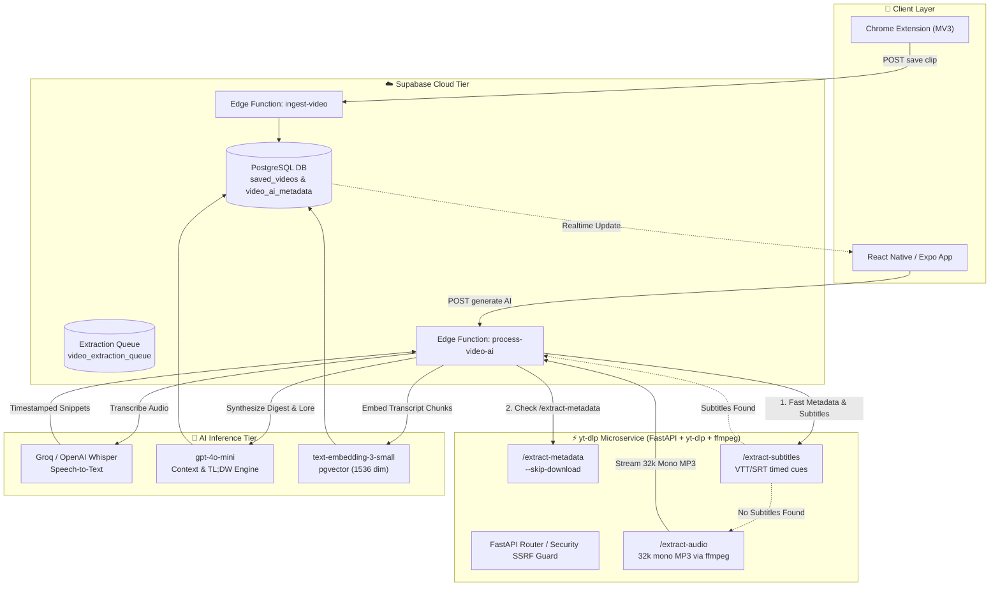

# ✦ Elio AI - yt-dlp Companion Service & End-to-End Extraction Architecture

> **Document Type:** Production Architecture Plan & Service Contract  
> **Target Service:** `backend/yt-dlp-service/`  
> **Key Implementers:** `@service-builder` (Microservice), `@verifier` (QA & Testing), `@architect` (System Design)  
> **Status:** APPROVED & READY FOR IMPLEMENTATION

---

## 1. Executive Summary & Problem Context

Elio AI powers cross-platform video capture, deep spoken context extraction, timestamped navigation, and conversational RAG ("Ask Elio") across YouTube, Instagram Reels, TikTok, Twitter/X, Reddit, and Facebook.

### 1.1 The Challenge with Edge-Only Extraction
Previously, extraction in `backend/supabase/functions/process-video-ai/` relied on direct web scraping (desktop HTML regex and InnerTube Android API calls) and regex scraping of `.mp4` URLs:
1. **Binary & Memory Limitations:** Supabase Edge Functions run on Deno/V8 isolates without direct access to native binary tools like `ffmpeg` or `yt-dlp`.
2. **Anti-Bot & Consent Walls:** YouTube, Instagram, and TikTok frequently change DOM layouts, require JS challenge solving, or return HTTP 429 / bot consent walls for web scraper headers.
3. **Audio Extraction Failures:** Social platforms stream media via segmented MPEG-DASH or HLS streams rather than static `.mp4` files. Direct HTTP download fails on 80%+ of Reels and TikToks.
4. **Whisper File Size Caps:** OpenAI Whisper imposes a strict 25 MB payload limit. Raw audio or video streams from 10+ minute videos routinely exceed this limit without real-time downsampling/compression.

### 1.2 The Solution: Dedicated yt-dlp Companion Microservice
Deploy a lightweight, resilient Python FastAPI companion microservice (`backend/yt-dlp-service`) bundled with `yt-dlp` and `ffmpeg`:
- **1000+ Platforms Out-of-the-Box:** Inherits battle-tested extractors for YouTube, Instagram, TikTok, X, Facebook, Reddit, Twitch, Vimeo, Bilibili, and more.
- **Zero-Download Subtitle Extraction:** Pulls timed subtitles (manual & auto-generated) directly from stream manifests without downloading any video bytes (< 2s latency).
- **Speech-Optimized Audio Pipeline:** Extracts and compresses audio directly to 32 kbps mono MP3 (16 kHz), reducing 1 hour of speech to ~14.4 MB—well within Whisper's 25 MB ceiling.
- **Dual Invocation Model:** Supports both synchronous HTTP calls (from Supabase Edge Functions for fast digests) and an asynchronous Supabase queue (`video_extraction_queue`) for long-form content.

---

## 2. End-to-End System Architecture



---

## 3. Microservice Specification & API Contract (`backend/yt-dlp-service/`)

### 3.1 Technology Stack & Base Configuration
- **Framework:** FastAPI (Python 3.11+, Pydantic v2, Uvicorn)
- **Core Libraries:** `yt-dlp>=2024.08.06`, `ffmpeg-python` or direct `ffmpeg` subprocess, `httpx`, `pydantic`
- **Default Port:** `8000` (configurable via `PORT` environment variable)
- **Authentication:** Service-to-service Bearer token via `Authorization: Bearer <YT_DLP_SERVICE_KEY>` or `X-API-Key: <YT_DLP_SERVICE_KEY>`
- **Concurrency & Workers:** Async worker pool managed by Uvicorn with concurrency semaphore limiting concurrent FFmpeg tasks (`MAX_CONCURRENT_EXTRACTIONS=10`)

---

### 3.2 Security & SSRF Protection Architecture
Because this service accepts external URLs, it implements strict SSRF (Server-Side Request Forgery) protection:
1. **IP & Protocol Validation:** Only `http` and `https` schemes permitted. Localhost (`127.0.0.1`, `::1`), private subnets (`10.0.0.0/8`, `172.16.0.0/12`, `192.168.0.0/16`), link-local metadata endpoints (`169.254.169.254`), and cloud internal hostnames are strictly blocked before invoking `yt-dlp`.
2. **Execution Safety:** Pure Python API invocations (`import yt_dlp`) rather than raw shell command strings (`os.system`), preventing command injection.
3. **Temp Directory Sandboxing:** All extracted audio files are written to a sandboxed `/tmp/elio-ytdlp/` directory with unique UUID filenames and immediate cleanup hooks.

---

### 3.3 Endpoint Specifications

#### 1. Healthcheck: `GET /health`
Returns the operational health of the container, yt-dlp version, ffmpeg presence, and available scratch disk space.

- **Request:** None
- **Response Headers:** `Content-Type: application/json`
- **Response Schema:**
```json
{
  "status": "healthy",
  "version": "1.0.0",
  "ytdlp_version": "2024.08.06",
  "ffmpeg_available": true,
  "ffprobe_available": true,
  "active_tasks": 0,
  "temp_dir_free_mb": 45120
}
```

---

#### 2. Extract Metadata: `POST /extract-metadata`
Extracts rich video metadata and available subtitle tracks without downloading video media.

- **Request Headers:**
  - `Content-Type: application/json`
  - `Authorization: Bearer <YT_DLP_SERVICE_KEY>`
- **Request Schema:**
```json
{
  "url": "https://www.youtube.com/watch?v=dQw4w9WgXcQ",
  "include_raw": false,
  "proxy": null
}
```

- **Response Schema (`200 OK`):**
```json
{
  "success": true,
  "platform": "youtube",
  "video_id": "dQw4w9WgXcQ",
  "title": "Rick Astley - Never Gonna Give You Up (Official Music Video)",
  "description": "The official video for “Never Gonna Give You Up” by Rick Astley...",
  "uploader": "Rick Astley",
  "uploader_id": "@RickAstleyYT",
  "channel_url": "https://www.youtube.com/channel/UCuAXFkgsw1L7xaCfnd5JJOw",
  "duration": 213,
  "view_count": 1540200300,
  "like_count": 17400000,
  "upload_date": "20091024",
  "thumbnail": "https://i.ytimg.com/vi/dQw4w9WgXcQ/maxresdefault.jpg",
  "webpage_url": "https://www.youtube.com/watch?v=dQw4w9WgXcQ",
  "available_subtitles": ["en", "es", "fr", "de"],
  "auto_subtitles": ["en", "hi", "ur", "es", "ja"],
  "formats_summary": [
    {
      "format_id": "140",
      "ext": "m4a",
      "vcodec": "none",
      "acodec": "mp4a.40.2",
      "abr": 128
    },
    {
      "format_id": "18",
      "ext": "mp4",
      "vcodec": "avc1.42001E",
      "acodec": "mp4a.40.2",
      "resolution": "640x360"
    }
  ],
  "error": null
}
```

- **Core `yt-dlp` Options:**
```python
ydl_opts = {
    'skip_download': True,
    'extract_flat': False,
    'quiet': True,
    'no_warnings': True,
    'ignoreerrors': False,
}
```

---

#### 3. Extract Subtitles: `POST /extract-subtitles`
Pulls manual or auto-generated subtitle tracks, parses the VTT/SRT timing cues into structured snippets, and returns the full transcript text. No audio or video is downloaded.

- **Request Schema:**
```json
{
  "url": "https://www.youtube.com/watch?v=dQw4w9WgXcQ",
  "preferred_languages": ["en", "hi", "ur", "es"],
  "include_auto": true,
  "format": "snippets"
}
```

- **Response Schema (`200 OK`):**
```json
{
  "success": true,
  "language": "en",
  "is_auto": false,
  "full_text": "We're no strangers to love. You know the rules and so do I. A full commitment's what I'm thinking of...",
  "snippets": [
    {
      "text": "We're no strangers to love",
      "start": 18.5,
      "duration": 4.2
    },
    {
      "text": "You know the rules and so do I",
      "start": 23.0,
      "duration": 4.1
    },
    {
      "text": "A full commitment's what I'm thinking of",
      "start": 27.5,
      "duration": 4.5
    }
  ],
  "available_tracks": ["en", "es", "fr", "auto-en", "auto-hi", "auto-ur"],
  "error": null
}
```

- **Core `yt-dlp` Options & Parsing Strategy:**
```python
ydl_opts = {
    'skip_download': True,
    'writesubtitles': True,
    'writeautomaticsub': include_auto,
    'subtitleslangs': preferred_languages or ['en'],
    'subtitlesformat': 'vtt/srt/best',
    'quiet': True,
    'no_warnings': True,
}
```
*Note on Subtitle Extraction:* `yt-dlp` fetches the subtitle manifest XML/VTT directly over HTTP via the video's extractor. The service parses VTT cue lines (`00:00:18.500 --> 00:00:22.700`), strips HTML/formatting artifacts (`<c>`, `<b>`, `&amp;`), calculates `start` and `duration` in seconds, and returns cleanly formatted JSON snippets compatible with Elio's `TranscriptSnippet` interface.

---

#### 4. Extract Audio Stream: `POST /extract-audio`
Downloads only the best audio stream, converts it via FFmpeg to a lightweight mono speech format, and streams the binary audio back to the caller (or saves it for asynchronous batch processing).

- **Request Schema:**
```json
{
  "url": "https://www.youtube.com/watch?v=dQw4w9WgXcQ",
  "format": "mp3",
  "bitrate": "32k",
  "sample_rate": 16000,
  "channels": 1,
  "max_duration_seconds": 1800,
  "return_mode": "stream"
}
```

- **Response (`return_mode="stream"`):**
  - **Status:** `200 OK`
  - **Headers:**
    - `Content-Type: audio/mpeg`
    - `Content-Disposition: attachment; filename="audio_dQw4w9WgXcQ.mp3"`
    - `X-Audio-Duration: 213`
    - `X-Audio-Bitrate: 32k`
    - `X-Audio-Channels: 1`
    - `X-Audio-Sample-Rate: 16000`
  - **Body:** Binary MP3 audio stream.

- **Response (`return_mode="json"` for asynchronous jobs):**
```json
{
  "success": true,
  "file_id": "c4b3f8a1-0982-411a-8c90-9f1234567890",
  "file_name": "audio_dQw4w9WgXcQ.mp3",
  "duration_seconds": 213,
  "file_size_bytes": 852000,
  "mime_type": "audio/mpeg",
  "bitrate": "32k",
  "channels": 1,
  "sample_rate": 16000,
  "download_url": "/download/c4b3f8a1-0982-411a-8c90-9f1234567890",
  "error": null
}
```

- **Speech-Optimized FFmpeg Pipeline in `yt-dlp`:**
```python
ydl_opts = {
    'format': 'bestaudio/best',
    'outtmpl': f'{temp_dir}/%(id)s.%(ext)s',
    'postprocessors': [
        {
            'key': 'FFmpegExtractAudio',
            'preferredcodec': 'mp3',
            'preferredquality': '32',
        }
    ],
    'postprocessor_args': [
        '-ac', '1',          # Downmix stereo to 1 channel (mono)
        '-ar', '16000',      # Resample to 16 kHz (native Whisper sampling rate)
        '-b:a', '32k',       # 32 kbps CBR
    ],
    'quiet': True,
    'no_warnings': True,
    'max_filesize': 50 * 1024 * 1024, # 50 MB safety cap
}
```

- **Whisper Size Optimization Math:**
  $$\text{Size per hour} = \frac{32,000\text{ bits/s} \times 3,600\text{ s}}{8\text{ bits/byte} \times 1,024 \times 1,024} \approx 13.73\text{ MB/hour}$$
  A 30-minute podcast or tutorial is under **7 MB**, and a 60-second Instagram Reel or TikTok clip is under **250 KB**. This guarantees 100% compatibility with OpenAI and Groq Whisper limits!

- **Guaranteed Scratch Disk Cleanup:**
  Using FastAPI's `BackgroundTasks`, every generated audio file is scheduled for guaranteed unlinking (`os.remove`) immediately after the HTTP streaming response finishes transmitting:
  ```python
  @app.post("/extract-audio")
  async def extract_audio_endpoint(req: AudioExtractRequest, background_tasks: BackgroundTasks):
      audio_path, meta = await extract_audio_service(req)
      background_tasks.add_task(cleanup_file, audio_path)
      return FileResponse(
          path=audio_path,
          media_type="audio/mpeg",
          filename=f"audio_{meta['id']}.mp3",
          headers={
              "X-Audio-Duration": str(meta["duration"]),
              "X-Audio-Bitrate": req.bitrate,
          }
      )
  ```

---

### 3.4 Error Codes and Handling Contract

| HTTP Status | Reason | Microservice Error Code | Handling in Supabase Edge Function |
| :--- | :--- | :--- | :--- |
| `400 Bad Request` | Missing or invalid URL format | `INVALID_URL` | Return 400 to client |
| `403 Forbidden` | Private video, login-required post, or SSRF blocked IP | `ACCESS_DENIED` or `SSRF_BLOCKED` | Fallback to user notes or graceful card |
| `404 Not Found` | Video removed, deleted, or geoblocked | `VIDEO_UNAVAILABLE` | Mark `processing_status = 'failed'` with clear reason |
| `413 Payload Too Large` | Video duration exceeds max limit (e.g. > 1 hour) | `DURATION_EXCEEDED` | Return user notice suggesting clipping |
| `429 Too Many Requests` | Platform rate limit or IP challenge | `UPSTREAM_RATE_LIMITED` | Retry with exponential backoff or proxy |
| `500 Internal Error` | yt-dlp or ffmpeg extraction failure | `EXTRACTION_FAILED` | Fallback to InnerTube or social scraper |

---

## 4. Supabase Database Queue & Webhook Schema

To support long-form videos (> 15 minutes) and batch ingestion without holding edge function connections open, the system provides an asynchronous queue in PostgreSQL.

### 4.1 Migration File: `backend/migrations/20261124_yt_dlp_queue_schema.sql`

```sql
-- ====================================================================
-- ✦ ELIO AI - YT-DLP EXTRACTION QUEUE & ASYNC PIPELINE SCHEMA
-- Run this in Supabase SQL Editor
-- ====================================================================

-- 1. Create extraction task enum types
DO $$ BEGIN
    CREATE TYPE public.extraction_task_type AS ENUM ('metadata', 'subtitles', 'audio_whisper', 'full_pipeline');
EXCEPTION
    WHEN duplicate_object THEN null;
END $$;

DO $$ BEGIN
    CREATE TYPE public.extraction_job_status AS ENUM ('pending', 'processing', 'completed', 'failed', 'retry');
EXCEPTION
    WHEN duplicate_object THEN null;
END $$;

-- 2. Create the Extraction Queue Table
CREATE TABLE IF NOT EXISTS public.video_extraction_queue (
    id UUID PRIMARY KEY DEFAULT gen_random_uuid(),
    video_id UUID NOT NULL REFERENCES public.saved_videos(id) ON DELETE CASCADE,
    user_id UUID NOT NULL REFERENCES auth.users(id) ON DELETE CASCADE,
    clean_url TEXT NOT NULL,
    platform VARCHAR(50) NOT NULL,
    task_type public.extraction_task_type NOT NULL DEFAULT 'full_pipeline',
    status public.extraction_job_status NOT NULL DEFAULT 'pending',
    priority INT NOT NULL DEFAULT 5, -- 10 = Pro/User on-demand, 5 = Standard Ingest, 1 = Background Refresh
    attempts INT NOT NULL DEFAULT 0,
    max_attempts INT NOT NULL DEFAULT 3,
    locked_until TIMESTAMPTZ,
    locked_by TEXT,
    payload JSONB DEFAULT '{}'::jsonb, -- e.g. { "preferred_languages": ["en", "hi"], "force_whisper": false }
    result JSONB DEFAULT '{}'::jsonb,  -- Result metadata, subtitle count, or audio stats
    error_message TEXT,
    created_at TIMESTAMPTZ DEFAULT NOW(),
    started_at TIMESTAMPTZ,
    completed_at TIMESTAMPTZ,
    updated_at TIMESTAMPTZ DEFAULT NOW()
);

-- Indices for rapid polling, priority dequeue, and video tracking
CREATE INDEX IF NOT EXISTS idx_extraction_queue_dequeue 
    ON public.video_extraction_queue(status, priority DESC, created_at ASC)
    WHERE status IN ('pending', 'retry');

CREATE INDEX IF NOT EXISTS idx_extraction_queue_video 
    ON public.video_extraction_queue(video_id);

CREATE INDEX IF NOT EXISTS idx_extraction_queue_user 
    ON public.video_extraction_queue(user_id);

-- 3. Row Level Security (RLS)
ALTER TABLE public.video_extraction_queue ENABLE ROW LEVEL SECURITY;

-- Users can view status of their own extraction jobs
CREATE POLICY "Users can view own extraction jobs"
    ON public.video_extraction_queue
    FOR SELECT
    USING (auth.uid() = user_id);

-- Service role full access
CREATE POLICY "Service role full access on extraction queue"
    ON public.video_extraction_queue
    FOR ALL
    USING (auth.role() = 'service_role');

-- 4. Atomic Dequeue Function (Skip Locked for high-concurrency workers)
CREATE OR REPLACE FUNCTION public.dequeue_extraction_job(
    p_worker_id TEXT,
    p_lock_duration_seconds INT DEFAULT 300
)
RETURNS TABLE (
    job_id UUID,
    job_video_id UUID,
    job_user_id UUID,
    job_clean_url TEXT,
    job_platform VARCHAR(50),
    job_task_type public.extraction_task_type,
    job_payload JSONB
)
LANGUAGE plpgsql
SECURITY DEFINER
SET search_path = public, pg_temp
AS $$
BEGIN
    RETURN QUERY
    WITH target_job AS (
        SELECT id
        FROM public.video_extraction_queue
        WHERE (status = 'pending' OR (status = 'retry' AND attempts < max_attempts))
          AND (locked_until IS NULL OR locked_until < NOW())
        ORDER BY priority DESC, created_at ASC
        LIMIT 1
        FOR UPDATE SKIP LOCKED
    )
    UPDATE public.video_extraction_queue q
    SET 
        status = 'processing',
        locked_by = p_worker_id,
        locked_until = NOW() + (p_lock_duration_seconds || ' seconds')::INTERVAL,
        started_at = COALESCE(q.started_at, NOW()),
        attempts = q.attempts + 1,
        updated_at = NOW()
    FROM target_job
    WHERE q.id = target_job.id
    RETURNING 
        q.id,
        q.video_id,
        q.user_id,
        q.clean_url,
        q.platform,
        q.task_type,
        q.payload;
END;
$$;

-- 5. Webhook Notification Trigger for Instant Processing
-- Emits pg_notify when a high-priority on-demand job is inserted
CREATE OR REPLACE FUNCTION public.notify_new_extraction_job()
RETURNS TRIGGER AS $$
BEGIN
    IF NEW.priority >= 8 AND NEW.status = 'pending' THEN
        PERFORM pg_notify('new_extraction_job', json_build_object(
            'job_id', NEW.id,
            'video_id', NEW.video_id,
            'task_type', NEW.task_type,
            'url', NEW.clean_url
        )::text);
    END IF;
    RETURN NEW;
END;
$$ LANGUAGE plpgsql;

DROP TRIGGER IF EXISTS trg_notify_new_extraction_job ON public.video_extraction_queue;
CREATE TRIGGER trg_notify_new_extraction_job
    AFTER INSERT ON public.video_extraction_queue
    FOR EACH ROW
    EXECUTE FUNCTION public.notify_new_extraction_job();
```

---

## 5. Client & Pipeline Integration Flow

### 5.1 Synchronous Extraction Flow (Fast Digest Path: < 2-4 seconds)
Used when a user saves a video or requests on-demand AI in the mobile app.

```mermaid
sequenceDiagram
    autonumber
    actor User as Mobile App / Extension
    participant Edge as process-video-ai (Edge Function)
    participant YTDLP as yt-dlp-service (FastAPI)
    participant Whisper as Groq Whisper Turbo
    participant GPT as gpt-4o-mini
    participant DB as Supabase PostgreSQL

    User->>Edge: POST /process-video-ai { video_id, force_whisper }
    Edge->>DB: UPDATE video_ai_metadata (status='scraping_metadata')
    
    rect rgb(240, 248, 255)
        Note over Edge,YTDLP: Step 1: Subtitle Extraction (Zero media download)
        Edge->>YTDLP: POST /extract-subtitles { url, preferred_languages: ["en","hi","ur","es"] }
        alt Subtitles Available (YouTube / Timed Captions)
            YTDLP-->>Edge: 200 OK { success: true, snippets: [...], full_text: "..." }
        else No Subtitles Found (Reels, TikToks, Uncaptioned)
            YTDLP-->>Edge: 200 OK { success: false, snippets: [] }
            Note over Edge,YTDLP: Step 2: Audio Stream Fallback
            Edge->>DB: UPDATE video_ai_metadata (status='transcribing')
            Edge->>YTDLP: POST /extract-audio { url, bitrate: "32k", return_mode: "stream" }
            YTDLP-->>Edge: 200 OK (Binary 32k Mono MP3 stream)
            Edge->>Whisper: POST /v1/audio/transcriptions (MP3 buffer)
            Whisper-->>Edge: 200 OK { snippets: [...], text: "..." }
        end
    end

    Edge->>DB: UPDATE video_ai_metadata (status='generating_context')
    Edge->>GPT: POST gpt-4o-mini (Synthesize TL;DW, Lore, Takeaways, Action Items)
    GPT-->>Edge: JSON { tldw, core_premise, context_breakdown, key_takeaways, action_items }

    Edge->>DB: UPSERT video_ai_metadata (completed) & chunks
    Edge-->>User: 200 OK { success: true, data: VideoAIMetadata }
```

### 5.2 Edge Function Routing & Fallback Matrix
In `backend/supabase/functions/process-video-ai/index.ts`:

1. **Check Environment Secrets:**
   ```typescript
   const ytDlpServiceUrl = Deno.env.get("YT_DLP_SERVICE_URL"); // e.g. "http://yt-dlp-service:8000" or cloud URL
   const ytDlpServiceKey = Deno.env.get("YT_DLP_SERVICE_KEY");
   ```
2. **Tiered Fallback Chain:**
   - **Tier 1 (Companion yt-dlp Service):** If `ytDlpServiceUrl` is configured, invoke `/extract-subtitles`. If non-empty, use directly. If empty, invoke `/extract-audio` and pass the compressed buffer to Groq/OpenAI Whisper.
   - **Tier 2 (Built-in InnerTube API Scraper):** If companion service is unconfigured or returns HTTP 5xx, fall back to existing `fetchYouTubeTranscript` in `transcriptScraper.ts`.
   - **Tier 3 (Social Meta Scraper):** If neither yields transcripts, fall back to `extractSocialContent` in `socialScraper.ts` for title/captions.

---

## 6. Service Implementation Blueprint for `@service-builder`

The microservice must be created inside `backend/yt-dlp-service/` with the following structure:

```
backend/yt-dlp-service/
├── Dockerfile                  # Container build with Python 3.11-slim & ffmpeg
├── README.md                   # Setup, curl commands, and architecture docs
├── requirements.txt            # Pinned dependencies
├── main.py                     # FastAPI application, CORS, routers & exception handlers
├── config.py                   # Pydantic Settings & environment variables
├── models.py                   # Pydantic v2 schemas for requests & responses
├── extractor.py                # Core yt-dlp wrapper (metadata, subtitles, audio)
├── utils/
│   ├── __init__.py
│   ├── ssrf.py                 # SSRF validation & IP guard
│   └── vtt_parser.py           # WebVTT/SRT timing parser -> TranscriptSnippet[]
└── test_service.py             # Pytest / standalone verification script
```

### 6.1 `requirements.txt`
```
fastapi>=0.111.0,<1.0.0
uvicorn[standard]>=0.30.0,<1.0.0
yt-dlp>=2024.8.6
pydantic>=2.7.0,<3.0.0
pydantic-settings>=2.3.0
httpx>=0.27.0
python-multipart>=0.0.9
```

### 6.2 Key Component Implementations

#### `utils/ssrf.py`: Strict SSRF URL & Hostname Guard
```python
import ipaddress
import socket
from urllib.parse import urlparse
from fastapi import HTTPException

BLOCKED_IP_NETWORKS = [
    ipaddress.ip_network("127.0.0.0/8"),       # Loopback
    ipaddress.ip_network("10.0.0.0/8"),        # Private Class A
    ipaddress.ip_network("172.16.0.0/12"),     # Private Class B
    ipaddress.ip_network("192.168.0.0/16"),    # Private Class C
    ipaddress.ip_network("169.254.0.0/16"),    # Link-local / Cloud metadata (AWS/GCP/Azure)
    ipaddress.ip_network("::1/128"),           # IPv6 loopback
    ipaddress.ip_network("fc00::/7"),          # IPv6 private
    ipaddress.ip_network("fe80::/10"),         # IPv6 link-local
]

def validate_safe_url(url: str) -> str:
    parsed = urlparse(url)
    if parsed.scheme not in ("http", "https"):
        raise HTTPException(status_code=400, detail="Invalid scheme: only HTTP and HTTPS allowed.")
    
    hostname = parsed.hostname
    if not hostname:
        raise HTTPException(status_code=400, detail="Invalid URL: missing hostname.")
    
    if hostname.lower() in ("localhost", "metadata.google.internal"):
        raise HTTPException(status_code=403, detail="SSRF protection: prohibited host.")
        
    try:
        addr_infos = socket.getaddrinfo(hostname, None)
        for addr in addr_infos:
            ip_str = addr[4][0]
            ip_obj = ipaddress.ip_address(ip_str)
            for network in BLOCKED_IP_NETWORKS:
                if ip_obj in network:
                    raise HTTPException(status_code=403, detail=f"SSRF protection: target resolves to private IP.")
    except socket.gaierror:
        raise HTTPException(status_code=400, detail="Hostname could not be resolved.")
        
    return url
```

#### `utils/vtt_parser.py`: WebVTT & SRT Cue Parser
```python
import re
from typing import List, Dict, Any

TIMESTAMP_REGEX = re.compile(
    r'(?:(\d{1,2}):)?(\d{2}):(\d{2})[.,](\d{3})\s*-->\s*(?:(\d{1,2}):)?(\d{2}):(\d{2})[.,](\d{3})'
)
TAG_CLEANER = re.compile(r'<[^>]+>')

def time_to_seconds(hours: str, minutes: str, seconds: str, millis: str) -> float:
    h = float(hours) if hours else 0.0
    m = float(minutes)
    s = float(seconds)
    ms = float(millis) / 1000.0
    return round(h * 3600 + m * 60 + s + ms, 2)

def parse_vtt_content(vtt_text: str) -> List[Dict[str, Any]]:
    snippets: List[Dict[str, Any]] = []
    lines = vtt_text.splitlines()
    i = 0
    while i < len(lines):
        line = lines[i].strip()
        match = TIMESTAMP_REGEX.search(line)
        if match:
            h1, m1, s1, ms1, h2, m2, s2, ms2 = match.groups()
            start = time_to_seconds(h1, m1, s1, ms1)
            end = time_to_seconds(h2, m2, s2, ms2)
            duration = max(round(end - start, 2), 0.5)
            
            # Read subsequent text lines until empty line
            i += 1
            text_lines = []
            while i < len(lines) and lines[i].strip():
                clean_text = TAG_CLEANER.sub('', lines[i]).strip()
                if clean_text and clean_text not in text_lines:
                    text_lines.append(clean_text)
                i += 1
                
            combined_text = " ".join(text_lines).strip()
            if combined_text:
                snippets.append({
                    "text": combined_text,
                    "start": start,
                    "duration": duration,
                })
        else:
            i += 1
            
    return snippets
```

#### `extractor.py`: Core Extraction Engine
```python
import os
import tempfile
import yt_dlp
from typing import Dict, Any, List, Optional
from utils.vtt_parser import parse_vtt_content

class YtDlpExtractor:
    def __init__(self, temp_base_dir: str = "/tmp/elio-ytdlp"):
        self.temp_base_dir = temp_base_dir
        os.makedirs(self.temp_base_dir, exist_ok=True)

    def extract_metadata(self, url: str) -> Dict[str, Any]:
        ydl_opts = {
            'skip_download': True,
            'extract_flat': False,
            'quiet': True,
            'no_warnings': True,
        }
        with yt_dlp.YoutubeDL(ydl_opts) as ydl:
            info = ydl.extract_info(url, download=False)
            
            subtitles = list(info.get('subtitles', {}).keys())
            auto_subs = list(info.get('automatic_captions', {}).keys())
            
            formats_summary = []
            for f in info.get('formats', [])[:15]:
                formats_summary.append({
                    "format_id": f.get("format_id"),
                    "ext": f.get("ext"),
                    "vcodec": f.get("vcodec"),
                    "acodec": f.get("acodec"),
                    "abr": f.get("abr"),
                    "resolution": f.get("resolution"),
                })
                
            return {
                "success": True,
                "platform": info.get("extractor_key", "unknown").lower(),
                "video_id": info.get("id"),
                "title": info.get("title"),
                "description": info.get("description", "")[:1000],
                "uploader": info.get("uploader") or info.get("channel"),
                "uploader_id": info.get("uploader_id"),
                "channel_url": info.get("channel_url") or info.get("uploader_url"),
                "duration": int(info.get("duration") or 0),
                "view_count": info.get("view_count"),
                "like_count": info.get("like_count"),
                "upload_date": info.get("upload_date"),
                "thumbnail": info.get("thumbnail"),
                "webpage_url": info.get("webpage_url", url),
                "available_subtitles": subtitles,
                "auto_subtitles": auto_subs,
                "formats_summary": formats_summary,
                "error": None,
            }

    def extract_subtitles(self, url: str, preferred_languages: Optional[List[str]] = None, include_auto: bool = True) -> Dict[str, Any]:
        preferred = preferred_languages or ["en", "hi", "ur", "es"]
        
        # Step 1: Query available subtitles
        ydl_opts = {
            'skip_download': True,
            'quiet': True,
            'no_warnings': True,
        }
        with yt_dlp.YoutubeDL(ydl_opts) as ydl:
            info = ydl.extract_info(url, download=False)
            
        subs = info.get('subtitles', {})
        auto_subs = info.get('automatic_captions', {}) if include_auto else {}
        
        target_lang = None
        is_auto = False
        track_url = None
        
        # Priority match: Manual subs first, then auto
        for lang in preferred:
            if lang in subs and len(subs[lang]) > 0:
                target_lang = lang
                is_auto = False
                break
        if not target_lang and include_auto:
            for lang in preferred:
                if lang in auto_subs and len(auto_subs[lang]) > 0:
                    target_lang = lang
                    is_auto = True
                    break
                    
        # If preferred not matched, pick first available
        if not target_lang:
            if subs:
                target_lang = next(iter(subs.keys()))
                is_auto = False
            elif auto_subs:
                target_lang = next(iter(auto_subs.keys()))
                is_auto = True

        if not target_lang:
            return {
                "success": False,
                "language": "none",
                "is_auto": False,
                "snippets": [],
                "full_text": "",
                "available_tracks": list(subs.keys()) + [f"auto-{k}" for k in auto_subs.keys()],
                "error": "No subtitles found for requested languages",
            }

        # Step 2: Download raw subtitle track into memory using temp dir
        with tempfile.TemporaryDirectory(dir=self.temp_base_dir) as tmpdir:
            download_opts = {
                'skip_download': True,
                'writesubtitles': not is_auto,
                'writeautomaticsub': is_auto,
                'subtitleslangs': [target_lang],
                'subtitlesformat': 'vtt',
                'outtmpl': f'{tmpdir}/sub',
                'quiet': True,
                'no_warnings': True,
            }
            with yt_dlp.YoutubeDL(download_opts) as sub_ydl:
                sub_ydl.download([url])
                
            snippets = []
            full_text = ""
            for fname in os.listdir(tmpdir):
                if fname.endswith(('.vtt', '.srt')):
                    with open(os.path.join(tmpdir, fname), 'r', encoding='utf-8', errors='ignore') as f:
                        raw = f.read()
                        snippets = parse_vtt_content(raw)
                        full_text = " ".join([s["text"] for s in snippets])
                    break
                    
            return {
                "success": len(snippets) > 0,
                "language": target_lang,
                "is_auto": is_auto,
                "snippets": snippets,
                "full_text": full_text,
                "available_tracks": list(subs.keys()) + [f"auto-{k}" for k in auto_subs.keys()],
                "error": None if len(snippets) > 0 else "Subtitle tracks existed in metadata but could not be parsed",
            }

    def extract_audio(self, url: str, bitrate: str = "32k", max_duration_sec: int = 1800) -> Dict[str, Any]:
        # Pre-check duration
        meta = self.extract_metadata(url)
        duration = meta.get("duration", 0)
        if duration > max_duration_sec:
            raise ValueError(f"Video duration ({duration}s) exceeds maximum allowed ({max_duration_sec}s)")

        file_id = os.urandom(8).hex()
        out_template = os.path.join(self.temp_base_dir, f"{file_id}.%(ext)s")
        target_path = os.path.join(self.temp_base_dir, f"{file_id}.mp3")

        ydl_opts = {
            'format': 'bestaudio/best',
            'outtmpl': out_template,
            'postprocessors': [{
                'key': 'FFmpegExtractAudio',
                'preferredcodec': 'mp3',
                'preferredquality': bitrate.replace('k', ''),
            }],
            'postprocessor_args': [
                '-ac', '1',
                '-ar', '16000',
            ],
            'quiet': True,
            'no_warnings': True,
        }

        with yt_dlp.YoutubeDL(ydl_opts) as ydl:
            ydl.download([url])

        if not os.path.exists(target_path):
            raise RuntimeError("Audio extraction failed: output file not found")

        return {
            "file_path": target_path,
            "duration": duration,
            "size_bytes": os.path.getsize(target_path),
            "video_id": meta.get("video_id", file_id),
            "title": meta.get("title", ""),
        }
```

### 6.3 Containerization (`Dockerfile`)
```dockerfile
FROM python:3.11-slim

# Install system dependencies: ffmpeg, ffprobe, and certificates
RUN apt-get update && apt-get install -y --no-install-recommends \
    ffmpeg \
    ca-certificates \
    curl \
    && rm -rf /var/lib/apt/lists/*

WORKDIR /app

# Install Python requirements
COPY requirements.txt .
RUN pip install --no-cache-dir -r requirements.txt

# Create application user and scratch temp dir
RUN useradd -m -u 1001 elio && \
    mkdir -p /tmp/elio-ytdlp && \
    chown -R elio:elio /tmp/elio-ytdlp /app

USER elio

COPY --chown=elio:elio . .

ENV PORT=8000 \
    TEMP_BASE_DIR=/tmp/elio-ytdlp \
    PYTHONUNBUFFERED=1

EXPOSE 8000

HEALTHCHECK --interval=30s --timeout=5s --start-period=5s --retries=3 \
    CMD curl -f http://localhost:8000/health || exit 1

CMD ["uvicorn", "main.py:app", "--host", "0.0.0.0", "--port", "8000"]
```

---

## 7. Verification & Quality Assurance Guide for `@verifier`

### 7.1 Verification Checklist & Acceptance Criteria

- [ ] **Contract Compliance:** All 3 core endpoints (`/extract-metadata`, `/extract-subtitles`, `/extract-audio`) adhere strictly to the JSON request/response schema.
- [ ] **Zero Video Download for Subtitles:** Running `/extract-subtitles` performs pure manifest and VTT downloads without fetching `.mp4` chunks. Verify bandwidth and disk remain minimal.
- [ ] **Audio Compression Target:** An extracted 10-minute test audio file at `32k` mono 16 kHz must be under **2.5 MB** and stream with valid audio headers.
- [ ] **SSRF & Security Isolation:**
  - `POST /extract-metadata` with `http://127.0.0.1:8000/health` must return `HTTP 403 Forbidden`.
  - `POST /extract-metadata` with `http://169.254.169.254/latest/meta-data/` must return `HTTP 403 Forbidden`.
- [ ] **Temp File Cleanup:** After streaming an audio response, `/tmp/elio-ytdlp/` must not contain leaked or leftover `.mp3` files.
- [ ] **Syntax & Type Health:** Python syntax checks and type annotations pass cleanly (`python3 -m py_compile **/*.py`).

### 7.2 Manual Verification Commands (cURL)

```bash
# 1. Healthcheck
curl -s http://localhost:8000/health | jq .

# 2. Extract Metadata from YouTube
curl -s -X POST http://localhost:8000/extract-metadata \
  -H "Content-Type: application/json" \
  -H "Authorization: Bearer test_secret" \
  -d '{"url": "https://www.youtube.com/watch?v=dQw4w9WgXcQ"}' | jq .

# 3. Extract Subtitles without downloading video
curl -s -X POST http://localhost:8000/extract-subtitles \
  -H "Content-Type: application/json" \
  -H "Authorization: Bearer test_secret" \
  -d '{"url": "https://www.youtube.com/watch?v=dQw4w9WgXcQ", "preferred_languages": ["en"]}' | jq '{success, language, is_auto, snippet_count: (.snippets | length), sample: .snippets[0]}'

# 4. Extract Compressed 32k Mono Audio Stream
curl -s -X POST http://localhost:8000/extract-audio \
  -H "Content-Type: application/json" \
  -H "Authorization: Bearer test_secret" \
  -d '{"url": "https://www.youtube.com/watch?v=dQw4w9WgXcQ", "bitrate": "32k", "return_mode": "stream"}' \
  --output /tmp/test_extracted.mp3

# Check audio file size and properties
ls -lh /tmp/test_extracted.mp3
ffprobe -hide_banner /tmp/test_extracted.mp3

# 5. SSRF Security Guard Test
curl -s -i -X POST http://localhost:8000/extract-metadata \
  -H "Content-Type: application/json" \
  -H "Authorization: Bearer test_secret" \
  -d '{"url": "http://127.0.0.1:8000/admin"}'
# Expect HTTP 403 Forbidden
```

---

## 8. Summary of Responsibilities & Next Actions

1. **`@architect` (Completed):** Complete architectural design, API contracts, Supabase queue schema, and verification guides published in `docs/YT_DLP_INTEGRATION_PLAN.md`.
2. **`@service-builder` (Next):** Implement `backend/yt-dlp-service/` containing `Dockerfile`, `README.md`, `requirements.txt`, `main.py`, `config.py`, `models.py`, `extractor.py`, `utils/ssrf.py`, and `utils/vtt_parser.py`. Run a local test, then notify `@verifier`.
3. **`@verifier` (Follow-up):** Run syntax checks, test endpoints, verify zero-download subtitle extraction, audio file size guarantees, and SSRF guard, then report `[done]` to `@coordinator`.
