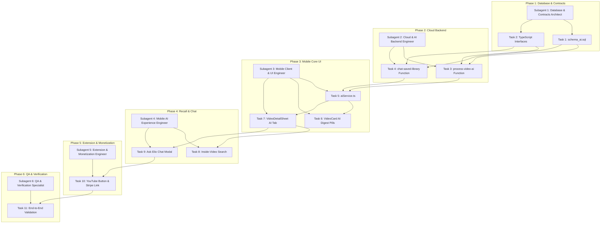

# Elio AI - Advanced AI Engine Implementation Plan (Phased & Subagent-Driven)

> **For agentic workers:** REQUIRED SUB-SKILL: Use `superpowers:subagent-driven-development` to implement this plan phase-by-phase. Steps use checkbox (`- [ ]`) syntax for tracking.
> **Verification Commands:** `cd mobile && npx tsc --noEmit` & `cd extension && npm run build`

**Goal:** Build and integrate all 5 core AI features and Freemium monetization into Elio AI using a 100% OpenAI-native pipeline (`gpt-4o-mini`, `text-embedding-3-small`, `whisper-1`) and Supabase `pgvector`.

**Architecture:** A 5-phase modular system divided among specialized subagents. A single-pass AI pipeline extracts digests, auto-tags, and action items in one request; video transcript chunks are embedded into Supabase `pgvector` for semantic inside-video timestamp recall and conversational RAG chat.

**Tech Stack:** React Native (Expo SDK 51, TypeScript), Supabase (PostgreSQL, `pgvector`, Deno Edge Functions), OpenAI API (`gpt-4o-mini`, `text-embedding-3-small`, `whisper-1`), Chrome Extension (Manifest V3, Vite).

**Spec:** [`docs/superpowers/specs/2026-11-07-ai-features-system1-system2-design.md`](file:///home/som2077/Desktop/Clipper/docs/superpowers/specs/2026-11-07-ai-features-system1-system2-design.md)

---

## Global Constraints

- OpenAI API key is accessed via `OPENAI_API_KEY` environment secret in Supabase Edge Functions.
- Vector embeddings dimension is strictly 1536 (`vector(1536)`) for `text-embedding-3-small`.
- No 24/7 background cron jobs (Feature 6 is removed to prevent recurring database scanning costs).
- YouTube transcriptions must use free subtitle scraper ($0 cost); OpenAI `whisper-1` is triggered on-demand only for uncaptioned Reels/TikToks.
- TypeScript strict checking must pass across mobile: `cd mobile && npx tsc --noEmit`.
- Extension build must pass: `cd extension && npm run build`.

## Review Focus

1. **Uncaptioned Video Handling:** If a reel has no captions and user has not requested audio Whisper, the UI must display a graceful "Generate AI Digest" button without failing.
2. **Offline Resilience:** If device is offline, previously viewed summaries must load from AsyncStorage cache.
3. **Timestamp Deep-Linking:** Tapping an inside-video search result timestamp (e.g. `04:12`) must format the URL with `&t=252s` (or `vnd.youtube:` intent) correctly.
4. **Usage Limit Gates:** Free users must be gated at 10 AI summaries per month with a prompt to upgrade to Elio Pro.
5. **Schema Conformance:** `gpt-4o-mini` calls must use `response_format: { type: "json_object" }` with validated fallbacks for missing arrays.

---

## 👥 Subagent Division & Phase Roadmap



---

## Phase 1: Database Architecture & Shared Contracts

**Assigned Subagent:** `Database & Contracts Architect`

### Task 1: Create Database AI Schema & pgvector Migration (`backend/schema_ai.sql`)

**Files:**

- Create: `backend/schema_ai.sql`

**Interfaces:**

- Produces: `public.user_subscriptions`, `public.video_ai_metadata`, `public.video_transcript_chunks`, and `public.match_video_chunks` RPC function.

- [ ] **Step 1: Write SQL migration file**
  - Enable `vector` extension.
  - Create `user_subscriptions` table (`user_id`, `tier`, `ai_summaries_used_this_month`, `current_period_end`).
  - Create `video_ai_metadata` table (`video_id`, `user_id`, `tldw`, `key_takeaways`, `action_items`, `primary_category`, `tags`, `processing_status`).
  - Create `video_transcript_chunks` table (`video_id`, `user_id`, `chunk_index`, `start_seconds`, `end_seconds`, `chunk_text`, `embedding vector(1536)`).
  - Add IVFFlat index on `embedding` column for cosine distance.
  - Add `match_video_chunks` RPC function taking `p_user_id UUID, p_embedding vector(1536), p_match_threshold FLOAT, p_match_count INT`.

- [ ] **Step 2: Commit Task 1**
  ```bash
  git add backend/schema_ai.sql
  git commit -m "feat(db): add pgvector schema and user subscriptions for AI engine"
  ```

---

### Task 2: Create TypeScript Contracts & Data Models

**Files:**

- Create: `mobile/types/ai.ts`
- Modify: `mobile/types/video.ts`

**Interfaces:**

- Consumes: Database schema from Task 1
- Produces: `VideoAIMetadata`, `ActionItem`, `AskElioMessage`, `SemanticSearchResult`, `UserSubscription`

- [ ] **Step 1: Write `mobile/types/ai.ts`**

  ```typescript
  export interface ActionItem {
    type: "link" | "repo" | "tool" | "recipe" | "book";
    title: string;
    url?: string;
    subtitle?: string;
  }

  export interface VideoAIMetadata {
    id: string;
    video_id: string;
    user_id: string;
    tldw: string;
    key_takeaways: string[];
    action_items: ActionItem[];
    primary_category: string;
    tags: string[];
    read_time_seconds: number;
    processing_status: "pending" | "completed" | "failed" | "skipped";
    created_at: string;
  }

  export interface SemanticSearchResult {
    chunk_id: string;
    video_id: string;
    title: string;
    clean_url: string;
    platform: string;
    thumbnail_url: string;
    start_seconds: number;
    end_seconds: number;
    chunk_text: string;
    similarity: number;
  }

  export interface AskElioMessage {
    id: string;
    role: "user" | "assistant";
    content: string;
    citations?: {
      video_id: string;
      title: string;
      timestamp_seconds: number;
      thumbnail_url?: string;
    }[];
    created_at: string;
  }

  export interface UserSubscription {
    tier: "free" | "pro" | "lifetime";
    ai_summaries_used_this_month: number;
    subscription_status: string;
  }
  ```

- [ ] **Step 2: Update `mobile/types/video.ts`**
      Add optional `ai_metadata?: VideoAIMetadata;` to `SavedVideo` interface.

- [ ] **Step 3: Verify TypeScript**
      Run: `cd mobile && npx tsc --noEmit`
      Expected: Clean exit (0 errors).

- [ ] **Step 4: Commit Task 2**
  ```bash
  git add mobile/types/ai.ts mobile/types/video.ts
  git commit -m "feat(types): define TypeScript models for AI metadata, chunks, and chat"
  ```

---

## Phase 2: Cloud Backend & Edge Functions Pipeline

**Assigned Subagent:** `Cloud & AI Backend Engineer`

### Task 3: Create Single-Pass Video Processing Edge Function (`process-video-ai`)

**Files:**

- Create: `backend/supabase/functions/process-video-ai/index.ts`
- Create: `backend/supabase/functions/process-video-ai/transcriptScraper.ts`

**Interfaces:**

- Consumes: `SavedVideo` payload + `OPENAI_API_KEY`
- Produces: Populated `video_ai_metadata` row and embedded rows in `video_transcript_chunks`

- [ ] **Step 1: Implement `transcriptScraper.ts`**
  - Extracts YouTube video ID from URL and fetches public captions track via YouTube timedtext endpoint.
  - If captions not present and `triggerWhisper === true`, downloads audio slice and calls OpenAI `whisper-1` API (`https://api.openai.com/v1/audio/transcriptions`).

- [ ] **Step 2: Implement `process-video-ai/index.ts`**
  - Verify user quota (`ai_summaries_used_this_month < 10` or `tier === 'pro'`).
  - Send transcript to OpenAI `gpt-4o-mini` with single-pass prompt:
    ```json
    {
      "tldw": "1-sentence summary",
      "key_takeaways": ["point 1", "point 2", "point 3"],
      "primary_category": "Tech",
      "tags": ["React", "TypeScript", "Next.js"],
      "action_items": [{ "type": "repo", "title": "GitHub Repo", "url": "..." }]
    }
    ```
  - Split transcript into 60-second overlapping chunks and call OpenAI `text-embedding-3-small` (batch embedding).
  - Insert chunks into `video_transcript_chunks` and summary into `video_ai_metadata`.

- [ ] **Step 3: Commit Task 3**
  ```bash
  git add backend/supabase/functions/process-video-ai
  git commit -m "feat(backend): implement single-pass OpenAI AI processing edge function"
  ```

---

### Task 4: Create Conversational RAG Edge Function (`chat-saved-library`)

**Files:**

- Create: `backend/supabase/functions/chat-saved-library/index.ts`

**Interfaces:**

- Consumes: `{ prompt: string, history: AskElioMessage[] }` + Bearer JWT
- Produces: Streamed text response with citations

- [ ] **Step 1: Implement vector retrieval and grounded chat**
  - Authenticate user via Supabase auth header.
  - Embed user query using OpenAI `text-embedding-3-small`.
  - Execute `match_video_chunks` RPC to fetch top 6 matching chunks from user's library.
  - Format system prompt instructing `gpt-4o-mini` to only answer from the provided chunks and provide citation anchors `[Video: {title} @ {timestamp}]`.
  - Stream response with Server-Sent Events (SSE).

- [ ] **Step 2: Commit Task 4**
  ```bash
  git add backend/supabase/functions/chat-saved-library
  git commit -m "feat(backend): implement RAG chat edge function with citation grounding"
  ```

---

## Phase 3: Mobile Services & Core Video UI Integration

**Assigned Subagent:** `Mobile Client & UI Engineer`

### Task 5: Implement Mobile AI Client Service (`aiService.ts`)

**Files:**

- Create: `mobile/services/aiService.ts`

**Interfaces:**

- Consumes: Supabase client & Edge functions
- Produces: `fetchVideoAIMetadata`, `generateVideoAIOnDemand`, `searchInsideVideosSemantic`, `streamAskElioChat`

- [ ] **Step 1: Implement `aiService.ts`**
  - Add AsyncStorage local caching with key `elio_ai_meta_${videoId}` for zero-latency instant offline replay.
  - Implement `fetchVideoAIMetadata(videoId: string): Promise<VideoAIMetadata | null>`.
  - Implement `generateVideoAIOnDemand(video: SavedVideo): Promise<VideoAIMetadata>`.
  - Implement `searchInsideVideosSemantic(query: string): Promise<SemanticSearchResult[]>`.
  - Implement `streamAskElioChat(prompt: string, history: AskElioMessage[], onChunk: (text: string) => void): Promise<void>`.

- [ ] **Step 2: Verify TypeScript**
      Run: `cd mobile && npx tsc --noEmit`
      Expected: 0 errors.

- [ ] **Step 3: Commit Task 5**
  ```bash
  git add mobile/services/aiService.ts
  git commit -m "feat(mobile): add aiService with offline cache and RPC helpers"
  ```

---

### Task 6: Add AI Digest Glow Badges & TL;DW Expanders to Video Cards

**Files:**

- Modify: `mobile/components/VideoCard.tsx`
- Modify: `mobile/components/VideoGridCard.tsx`

**Interfaces:**

- Consumes: `aiService.ts` and `SavedVideo.ai_metadata`

- [ ] **Step 1: Update `VideoCard.tsx`**
  - Add subtle indigo/violet glowing pill: `✦ AI Digest` next to platform badge.
  - Add 1-tap microinteraction: clicking the badge animates an in-card 1-sentence TL;DW teaser with haptic feedback.

- [ ] **Step 2: Update `VideoGridCard.tsx`**
  - Add optical sparkle icon indicator on the 2-column grid cards when AI digest is ready.

- [ ] **Step 3: Verify TypeScript**
      Run: `cd mobile && npx tsc --noEmit`

- [ ] **Step 4: Commit Task 6**
  ```bash
  git add mobile/components/VideoCard.tsx mobile/components/VideoGridCard.tsx
  git commit -m "feat(ui): add AI digest glow badges and inline TL;DW teasers"
  ```

---

### Task 7: Integrate AI Digest Tab & Action Items in `VideoDetailSheet.tsx`

**Files:**

- Modify: `mobile/components/VideoDetailSheet.tsx`

**Interfaces:**

- Consumes: `aiService.ts` and `VideoAIMetadata`

- [ ] **Step 1: Add segmented control in `VideoDetailSheet.tsx`**
  - Two segments: `Overview` and `✦ AI Digest & Actions`.
  - In `AI Digest` view:
    - Display 1-sentence TL;DW capsule with reading time badge.
    - Render 3-5 bullet Key Takeaways with 1-tap "Copy Takeaways" button (triggers `ToastHUD`).
    - Render Action Items strip: Clickable GitHub links (opens browser), recipe checklists with checkboxes, and tool mentions.
    - If AI metadata is not yet generated, display a sleek button: `✦ Generate AI Digest (30s)`.

- [ ] **Step 2: Verify TypeScript**
      Run: `cd mobile && npx tsc --noEmit`

- [ ] **Step 3: Commit Task 7**
  ```bash
  git add mobile/components/VideoDetailSheet.tsx
  git commit -m "feat(ui): add interactive AI Digest and Action Items in detail sheet"
  ```

---

## Phase 4: Advanced Recall & Conversational Search

**Assigned Subagent:** `Mobile AI Experience Engineer`

### Task 8: Implement Inside-Video Timestamp Search in `SearchBar.tsx`

**Files:**

- Modify: `mobile/components/SearchBar.tsx`
- Modify: `mobile/app/index.tsx`

**Interfaces:**

- Consumes: `searchInsideVideosSemantic` from `aiService.ts`

- [ ] **Step 1: Update `SearchBar.tsx`**
  - Add mode toggle button inside or below search bar: `Titles` | `Inside Video ✦`.
  - When `Inside Video ✦` is selected, placeholder changes to: _"Search what was said inside videos..."_.

- [ ] **Step 2: Update `mobile/app/index.tsx` search results feed**
  - When in semantic mode, render `SemanticSearchResult` cards displaying:
    - Video title & thumbnail.
    - Highlighted snippet of spoken transcript text.
    - Interactive timestamp pill: `▶ Jump to 04:15`.
    - Tapping timestamp deep-links directly to that second using `deepLink.ts`.

- [ ] **Step 3: Verify TypeScript**
      Run: `cd mobile && npx tsc --noEmit`

- [ ] **Step 4: Commit Task 8**
  ```bash
  git add mobile/components/SearchBar.tsx mobile/app/index.tsx
  git commit -m "feat(search): implement inside-the-video semantic search with timestamp jumps"
  ```

---

### Task 9: Implement "Ask Elio" Interactive Conversational RAG Modal

**Files:**

- Create: `mobile/components/AskElioModal.tsx`
- Modify: `mobile/components/FloatingTabBar.tsx`
- Modify: `mobile/app/index.tsx`

**Interfaces:**

- Consumes: `streamAskElioChat` from `aiService.ts`

- [ ] **Step 1: Create `AskElioModal.tsx`**
  - Full-screen or modal sheet with dark glass header and glowing sparkle icon.
  - Horizontal quick prompt chips: _"Summarize my React videos"_, _"Best workout tips saved"_, _"List tools mentioned this week"_.
  - Chat message bubbles with typing indicator and streaming markdown.
  - Citation cards at bottom of assistant messages linking directly to the source video.

- [ ] **Step 2: Wire entry trigger in `FloatingTabBar.tsx` and header**
  - Add AI Sparkle action icon to trigger Ask Elio.

- [ ] **Step 3: Verify TypeScript**
      Run: `cd mobile && npx tsc --noEmit`

- [ ] **Step 4: Commit Task 9**
  ```bash
  git add mobile/components/AskElioModal.tsx mobile/components/FloatingTabBar.tsx mobile/app/index.tsx
  git commit -m "feat(chat): implement Ask Elio conversational RAG modal with citations"
  ```

---

## Phase 5: Browser Extension Integration & Monetization

**Assigned Subagent:** `Extension & Monetization Engineer`

### Task 10: In-Page YouTube Summary Button & Stripe Checkout Entry

**Files:**

- Modify: `extension/src/content/youtube.ts`
- Modify: `extension/src/popup/popup.html`
- Modify: `extension/src/popup/popup.ts`

- [ ] **Step 1: Add in-page YouTube quick button in `youtube.ts`**
  - Detect YouTube watch page and inject clean optical button: `✦ Elio Summary` below the video title.
  - Clicking button opens a compact side drawer showing the 30-sec digest.

- [ ] **Step 2: Add Pro Tier & Upgrade button in `popup.html`**
  - Display user tier: `Free (7/10 digests used)` or `✦ Pro Member`.
  - Add "Upgrade to Elio Pro" button opening Stripe checkout link.

- [ ] **Step 3: Build extension**
      Run: `cd extension && npm run build`
      Expected: Clean build in `dist/`.

- [ ] **Step 4: Commit Task 10**
  ```bash
  git add extension/src/content/youtube.ts extension/src/popup
  git commit -m "feat(extension): add YouTube in-page summary trigger and Stripe upgrade entry"
  ```

---

## Phase 6: End-to-End Verification & Documentation

**Assigned Subagent:** `QA & Verification Specialist`

### Task 11: Full End-to-End Type Safety & Verification

**Files:**

- Modify: `README.md`

- [ ] **Step 1: Run comprehensive TypeScript check**
      Run: `cd mobile && npx tsc --noEmit`
      Expected: 0 errors.

- [ ] **Step 2: Build extension**
      Run: `cd extension && npm run build`
      Expected: Success.

- [ ] **Step 3: Update `README.md`**
      Add setup notes for `backend/schema_ai.sql` and `OPENAI_API_KEY`.

- [ ] **Step 4: Commit Task 11**
  ```bash
  git add README.md
  git commit -m "docs: document OpenAI AI engine setup and complete verification"
  ```
